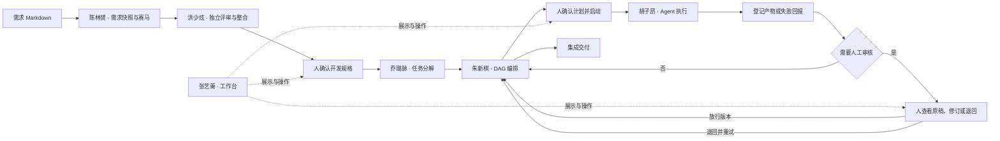

# 第五组 · 六人并行开发对接文档

当前 `main` 的骨架提交 `066cfb8` 可跑通 v1 模拟流程。六个分支开发下一轮正式功能时，以 [v2 接口契约](接口契约-v2.md) 和 [v2 联调样例](../examples/v2/scenario.json) 为共同依据。第 2 节记录当前 v1 的实际行为。

## 1. 全流程与交接



| 阶段 | 输入 → 交付 | 主理 AI | 人的权限 |
|---|---|---|---|
| 需求与赛马 | 原文 → 带版本的需求和各组草案 | 列出未确认项，各组共用同一快照，汇总前隔离其他组草案 | 补充、确认需求边界 |
| 评审与整合 | 草案 → 分项评分、分歧、规格 | 分别评估用户价值、可行性、成本，每项保留理由和原文出处。融合时记录采纳条目及冲突 | 选 A/B、修改融合方案、确认规格 |
| 分解与编排 | 规格 → 任务卡、DAG、版本化计划 | 查遗漏、悬空引用、路径冲突，解释程序校验结果 | 修改执行角色、估时、依赖、审核要求与并发，确认工作区并启动 |
| 开发执行 | 任务＋上游放行版本 → 尝试与产物 | 根据实际日志和产物指出失败影响，显示可重试或待补输入原因 | 暂停派发、恢复、重试、补输入 |
| 交付 | Agent 草稿 → 原稿、审阅记录、放行版本 | 对照规格和差异给出检查意见 | 审批原稿、批准人工修订版、退回并说明原因 |

主理 AI 的发现记录阶段、来源、证据、建议和影响范围。规格确认、产物放行及计划启动记录操作者与时间。引用、依赖成环、权限和状态流转由程序判断。独立任务在其他任务等待审核或失败时仍可继续。

## 2. 当前代码契约（v1）

入口是 `se_agent/server.py`。模块之间传递可序列化的 Python 字典；Web 通过 HTTP 使用同一份数据。以 `examples/` 和测试为接口基线。

| 调用方 → 实现 | 函数 | 交付字段 |
|---|---|---|
| 工作台 → 陈林赟 | `intake(markdown)`, `race(requirement)` | 需求 `id/version/markdown`；草案 `id/source/title/summary` |
| 流程入口 → 洪少炫 | `assess(drafts)`, `confirm(requirement,drafts,decision)` | 分数 `draft_id/value/feasibility/cost/reason`，1–5 分，成本分越高越省；规格 `id/version/requirement_id/source_draft_ids/markdown` |
| 流程入口 → 乔璐脉 | `decompose(spec)` | 计划 `id/version/spec/tasks/max_parallel`。任务 `id/title/depends_on/source/role/output/write_paths/estimate_minutes/review_required` |
| 流程入口 → 朱新棋 | `validate(plan)`, `Run(plan)` | `snapshot()` 返回 `plan_version/paused/ready/tasks/events/complete`。任务状态 `waiting/review/failed/done`，就绪由 `ready` 单独表达 |
| 编排器 → 胡子昂 | `execute(request)` | 输入 `attempt_id/task/inputs`。结果 `attempt_id/ok/content/error/provider/usage`。输入是已放行的产物版本 |
| 张艺薷 → Web API | HTTP JSON | 按项目读取完整快照，使用返回快照刷新画面。切换依赖图、甘特图和详情时保留选中任务 |

**HTTP 接口**

- `POST /api/projects` 提交 `{markdown}`，返回 201 与快照。
- `GET /api/projects/{id}` 获取 `id/requirement/drafts/scores/spec/plan/run`。
- `POST /api/projects/{id}/actions/{action}` 返回更新后的快照。业务错误统一用 `{error}` 返回。格式错误 400，找不到 404，阶段冲突或旧版本 409。

| action | 请求字段 | 条件 |
|---|---|---|
| confirm | `decision: "A" / "B" / "merge"` | 尚未确认规格 |
| configure | `version, max_parallel` | 尚未启动，成功生成下一计划版本 |
| start | `version` | 绑定当前计划，重复启动报冲突 |
| step | `{}` | 未暂停且存在就绪任务，推进一批 |
| pause / resume | `{}` | 控制新任务派发 |
| review | `task_id, version, decision, content, note` | 最新版本待审，决定为 `approve/revise/reject`。修订必须提交非空内容 |
| retry | `task_id` | 失败或审阅退回，下一次派发使用新尝试号 |

产物 `task_id/version/origin/content/approved/note`。审核产生新版本，原稿保留；退回版本不可传给下游。同一项目下计划、任务、尝试和产物均由项目 ID 限定。运行事件用递增 `seq` 排序。MVP 的主理 AI 文案和评分使用模板。

## 3. 组长分发的六张开发任务卡

把本页、v2 契约和样例一起发给对应 Agent，并附上分支名和共同起点提交。各分支先用固定样例完成自己的模块，再连接真实上下游。每个 PR 说明实现入口、接口变动、复现步骤和验收结果。

| 成员 / 分支 | 目录与上下游 | 首个 PR 交付与验收 |
|---|---|---|
| 陈林赟（组长） · `feat/intake-race` | `se_agent/intake.py` 及其模块文件。接工作台原文，向洪少炫交 Requirement 和 Draft | 存原文与行级来源，独立构思后分 A/B 出案，定义同一快照和隔离边界。验收用同版本需求生成两份有来源的草案，缺一组结果时显示原因并保持可重试 |
| 洪少炫 · `feat/review-synthesis` | `se_agent/synthesis.py` 及其模块文件。接 Requirement 和 Draft，向乔璐脉交 Specification | 生成三维评分依据、分歧、融合草稿及人工确认。验收覆盖 A/B/融合三种选择，保留采纳来源和未决项，拒绝悬空引用 |
| 乔璐脉 · `feat/task-planner` | `se_agent/planner.py` 及其模块文件。接已确认 Specification，向朱新棋交 Task[] | 写入任务来源、依赖、输出、改动范围、估时和审核要求，从编排器组装的 Plan 同源导出 `workflow.json` 与 `task.md`。用样例覆盖并行和汇合，T2 的未决输入只影响 T2 及其下游 |
| 朱新棋 · `feat/orchestrator` | `se_agent/orchestrator.py`、SQLite 存储、运行与计划 API。接 Plan，向胡子昂发 WorkerRequest，向张艺薷交运行快照 | 校验 DAG、存版本、派发、去重、恢复、审核和事件。注入模拟 Runner 验收环、并发和路径冲突、重启恢复、审核放行、重复提交、迟到回报和失败重试 |
| 胡子昂 · `feat/agent-runner` | `se_agent/runner.py` 及模型、工作区适配。接 WorkerRequest，向朱新棋交 WorkerResult | 保留模拟 Runner。用样例接工作区、上游产物和基线，再接真实执行和模型路由。验收包括纳入获准提交、输出在写入范围内、上报 Git SHA 和用量，以及合并失败返回带路径的结构化错误 |
| 张艺薷 · `feat/workbench` | `web/` 和端到端演示。消费 v2 HTTP 和事件 | 先用 fixture 渲染双方案对照、任务配置、依赖图、甘特图（短任务按分钟）、产物审阅与阻塞原因。验收从主区编辑估时、审核开关和依赖后保存；能批准人工修订版、处理版本冲突并保留选中任务 |

组长维护公共契约、样例、接口组合入口及合并顺序。成员需要变更共享字段、`contracts.py` 或 `server.py` 时，在自己的模块实现之前提交独立的小 PR，标出生产方、消费方和受影响样例，请上下游共同复核。朱新棋负责运行与计划 API，需求、赛马、规格模块提供自己的入口，由组长协调接入公共路由。

## 4. 并行开发与合并

1. **固定共同起点。** 骨架已在 GitHub。组长先把 v2 对接说明和样例合入 `main`，把该提交号作为开工起点，并给六条分支分发任务卡。已经开分支的成员同步这次文档提交。
2. **并行替换各模块。** 上游从固定需求开始，评审与分解从保存的样例开始，调度注入模拟 Runner，执行用 WorkerRequest 样例，工作台用快照和错误样例。继续运行现有 v1 测试，并记录本模块 v2 的验收结果。
3. **按接口合入。** 先合公共契约与公共路由，再接需求到规格、规格到计划、调度与执行。前端可以先合可对照样例的视图，真实 API 联调作为后续提交。每个 PR 由直接接口消费者复核，合并前跑测试和相关验收场景。
4. **收尾由组长验收。** 走一遍样例全链，记录运行 ID、版本、尝试号和实际消费的 SHA。所有模块都能在同一提交演示后，从该提交交付。

```bash
git clone https://github.com/Anjin001/SE-Development-Process-Agent.git
cd SE-Development-Process-Agent
git switch main
git pull --ff-only
git switch -c feat/your-module
python -m unittest discover -s tests -v
git push -u origin feat/your-module
```

把 `feat/your-module` 换成任务卡里的分支名。

## 5. 联调验收

| 操作 | 应观察到的结果 |
|---|---|
| 导入设备预约需求，确认融合方案 | 所有参赛草案和已确认决策都能追到同一需求版本及具体行号 |
| 尝试保存有环的计划，再保存合法计划 | 422 返回闭环；合法保存才生成新版本。旧版本启动请求返回 409 |
| 完成 T1，暂不补 T2 输入 | T3 继续派发。T2 显示缺项，T4 等待 |
| 补充 T2 输入，执行并提交产物 | T2 进入审核，T4 仍等待；独立分支可以继续 |
| 人工修订并批准 T2 | 原稿仍可读，产生下一版本。T4 请求和实际工作区都能追到获批 SHA |
| 退回、重试、重复提交、迟到回报 | 保留旧尝试；重试生成新尝试；相同操作重放一次；迟到回报不覆盖当前状态 |
| 运行中暂停，随后恢复；再重启服务 | 暂停期间允许已有尝试回报。恢复后再领取就绪任务。重启恢复事件顺序，过期租约可处理 |
| 看任务配置、依赖图、甘特与审阅 | 切换视图保留当前任务；显示相同依赖、版本、失败原因与起止时间 |

技术实施沿用 React / React Flow、FastAPI、SQLite、Python DAG、Git worktree 与 AutoGen 适配方向。首轮以同一个用例完成 v2 集成。更复杂的多仓库、运行中改图和已放行产物就地替换留到后续版本。
