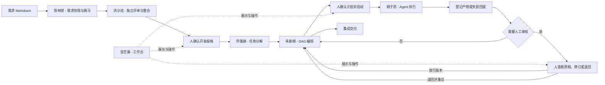

# 第五组 · 六人并行开发对接文档

## 1. 全流程与交接



| 阶段 | 输入 → 交付 | 主理 AI | 人的权限 |
|---|---|---|---|
| 需求与赛马 | 原文 → 带版本的需求、A/B 草案 | 列出未确认项，给两组同一快照，汇总前隔离对方草案 | 补充、确认需求边界 |
| 评审与整合 | 草案 → 分项评分、分歧、规格 | 分别评估用户价值、可行性、成本，每项保留理由和原文出处。融合时记录采纳条目及冲突 | 选 A/B、修改融合方案、确认规格 |
| 分解与编排 | 规格 → 任务卡、DAG、版本化计划 | 查遗漏、悬空引用、路径冲突，解释程序校验结果 | 修改执行角色、估时、依赖、审核要求与并发，确认工作区并启动 |
| 开发执行 | 任务＋上游放行版本 → 尝试与产物 | 根据实际日志和产物指出失败影响，显示可重试或待补输入原因 | 暂停派发、恢复、重试、补输入 |
| 交付 | Agent 草稿 → 原稿、审阅记录、放行版本 | 对照规格和差异给出检查意见 | 审批原稿、批准人工修订版、退回并说明原因 |

主理 AI 的发现记录阶段、来源、证据、建议和影响范围。规格确认、产物放行及计划启动记录操作者与时间。引用、依赖成环、权限和状态流转由程序判断。独立任务在其他任务等待审核或失败时仍可继续。

## 2. 当前代码契约（v1）

入口是 `se_agent/server.py`。模块之间传递可序列化的 Python 字典；Web 通过 HTTP 使用同一份数据。以 `examples/` 和测试为接口基线。

| 调用方 → 实现 | 函数 | 交付字段 |
|---|---|---|
| 工作台 → 陈林赟 | `intake(markdown)`, `race(requirement)` | 需求 `id/version/markdown`；草案 `id/source/title/summary` |
| 流程入口 → 洪少炫 | `assess(drafts)`, `confirm(requirement,drafts,decision)` | 分数 `draft_id/value/feasibility/cost/reason`，1–5 分，成本分越高越省；规格 `id/version/requirement_id/source_draft_ids/markdown` |
| 流程入口 → 乔璐脉 | `decompose(spec)` | 计划 `id/version/spec/tasks/max_parallel`。任务 `id/title/depends_on/source/role/output/write_paths/estimate_minutes/review_required` |
| 流程入口 → 朱新棋 | `validate(plan)`, `Run(plan)` | `snapshot()` 返回 `plan_version/paused/ready/tasks/events/complete`。任务状态 `waiting/review/failed/done`，就绪由 `ready` 单独表达 |
| 编排器 → 胡子昂 | `execute(request)` | 输入 `attempt_id/task/inputs`。结果 `attempt_id/ok/content/error/provider/usage`。输入是已放行的产物版本 |
| 张艺薷 → Web API | HTTP JSON | 按项目读取完整快照，使用返回快照刷新画面。切换依赖图、甘特图和详情时保留选中任务 |

**HTTP 接口**

- `POST /api/projects` 提交 `{markdown}`，返回 201 与快照。
- `GET /api/projects/{id}` 获取 `id/requirement/drafts/scores/spec/plan/run`。
- `POST /api/projects/{id}/actions/{action}` 返回更新后的快照。业务错误统一用 `{error}` 返回。格式错误 400，找不到 404，阶段冲突或旧版本 409。

| action | 请求字段 | 条件 |
|---|---|---|
| confirm | `decision: "A" / "B" / "merge"` | 尚未确认规格 |
| configure | `version, max_parallel` | 尚未启动，成功生成下一计划版本 |
| start | `version` | 绑定当前计划，重复启动报冲突 |
| step | `{}` | 未暂停且存在就绪任务，推进一批 |
| pause / resume | `{}` | 控制新任务派发 |
| review | `task_id, version, decision, content, note` | 最新版本待审，决定为 `approve/revise/reject`。修订必须提交非空内容 |
| retry | `task_id` | 失败或审阅退回，下一次派发使用新尝试号 |

产物 `task_id/version/origin/content/approved/note`。审核产生新版本，原稿保留；退回版本不可传给下游。同一项目下计划、任务、尝试和产物均由项目 ID 限定。运行事件用递增 `seq` 排序。MVP 的主理 AI 文案和评分使用模板。

## 3. 六人可直接转发的开发任务

每位成员从同一个骨架提交新建分支。给自己的 Agent 发送这一节对应行，并附完整对接文档、仓库地址和骨架提交号。第一项操作是运行 README 里的测试，再用固定样例开发。

| 成员 / 分支 | 主负责文件 | 直接交给 Agent 的任务和验收 |
|---|---|---|
| 陈林赟（组长） · `feat/intake-race` | `se_agent/intake.py` | 保持 v1 函数接口，做结构化需求提取、独立构思与 A/B 并行出案。把需求编号、约束、未决问题和草案来源交给洪少炫。用同一份需求走两组，确保正式汇总前没有互读。组长另负责公共契约变更和最终联调 |
| 洪少炫 · `feat/review-synthesis` | `se_agent/synthesis.py` | 从两份草案生成分项评价、证据和分歧。保留 A/B/融合选择，形成可确认的 Markdown 开发规格。验收时能从每条采用决策看到来源，未决项不会被填成事实 |
| 乔璐脉 · `feat/task-planner` | `se_agent/planner.py` | 根据规格拆出有交付物的任务，补来源段落、直接前置、写入范围和估时，生成 `workflow.json` 与 `task.md`。给朱新棋可编排的任务计划，给张艺薷可渲染的样例。验收包含并行分支和汇合 |
| 朱新棋 · `feat/orchestrator` | `se_agent/orchestrator.py`，运行存储及运行 API | 把内存调度替换为 SQLite 与异步 Worker 派发。实现状态、依赖检查、版本化计划、尝试回收、重试去重和审阅事务。用模拟 runner 验证重启恢复、失败连带阻塞、独立任务继续、人工结果传到下游 |
| 胡子昂 · `feat/agent-runner` | `se_agent/runner.py`，模型与工作区适配 | 保留模拟执行器，接模型路由与 Git worktree。对明确的小任务用低成本模型，复杂设计或故障复核升级。按任务范围工作，回报提交号、变更文件、用量和失败原因。先将样例交付返回给朱新棋，再接真实执行 |
| 张艺薷 · `feat/workbench` | `web/`，端到端联调 | 用 v1 快照实现在主区切换依赖图、时间轴、任务配置、审阅。选中任务看来源、尝试、提交和阻塞原因。演示点击修订、退回、批准。API 未接齐时用固定样例，接齐后运行端到端验收 |

需要改公共数据形状、`contracts.py` 或公共入口 `server.py` 的成员，先提交小型契约 PR，由涉及的上下游确认示例和兼容方案。其他成员先基于原有形状开发。允许加可选字段，变更已有字段语义前统一升级契约。

## 4. 从骨架升级到集成版

1. 先把这份可运行骨架作为首个 PR 合入 `main`，记录该提交哈希。已有仓库先检查内容，再把骨架放入该仓库适合的目录。六人各自从相同提交开分支，提交各自 PR。
2. 六模块同时开发。前端固定用样例快照，编排器注入模拟执行器，执行器用固定任务请求，评审与分解可各自用已保存的输入。首轮 PR 保留模拟路径，避免等待其他五组。
3. 优先合公共契约和测试，然后按依赖审查上游、分解、调度、执行与工作台。单个模块兼容骨架、测试通过即可合入。每次合并后从最新 `main` 更新分支。跨模块联调的修正由涉及模块负责人共同处理，组长维护主干。
4. 第一轮总验收用同一条设备预约需求贯穿。T1 交付后 T2/T3 可派发；T2 待审期间 T3 可完成；人工修订 T2 后 T4 消费修订版本。另演示失败或退回、重试保留旧记录、暂停与继续、旧版本提交被拒绝。真实接入后进一步验收下游 worktree 确实读取获批提交、重启后状态可恢复。

```bash
git clone <团队仓库地址>
git switch main
git pull --ff-only
git switch -c <表中的分支名>
python -m unittest discover -s tests -v
git push -u origin <表中的分支名>
```

后续计划沿用 React / React Flow 工作台、FastAPI、SQLite、Python DAG、Git worktree 和 AutoGen 适配方向。调度按依赖和资源派发，模型只提建议或执行分派任务。数据库原子记录状态、放行版本和事件，真实执行通过固定工作区和受限工具交接。甘特图保留计划与实际，短任务按分钟显示，较长项目按小时或天显示。MVP 只调整计划并发和人工审阅，其余任务配置、持久化、真实开发、模型调用和完整图表由对应分支实现。
