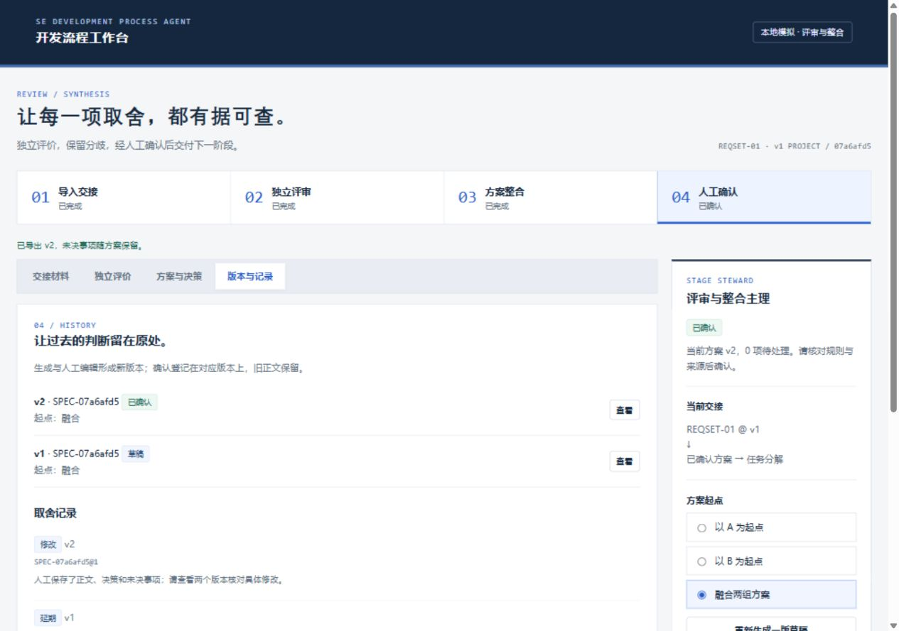
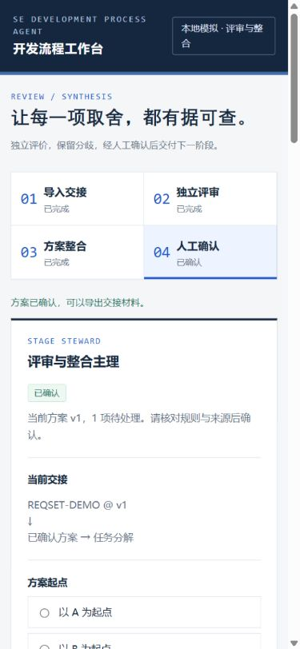

# HSX · 评审与方案整合

负责人：**洪少炫**。本分支负责从 Requirement / A、B Draft 到独立 Evaluation 和已确认 Specification 的第一轮原型。开发和提交在 `HSX`，合并由组长负责。

## 1. 运行和演示

在仓库根目录执行，仅需 Python 3.10+ 标准库：

```bash
python -m se_agent.synthesis_preview --port 8002
python -m unittest discover -s tests -v
```

打开 http://127.0.0.1:8002。服务只监听本机，使用单线程 HTTPServer 和独立内存存储；重启清空数据。浏览器页面重新加载后可重新导入，已导出的文件不受影响。

### 已有预约取舍演示

1. 点击「加载取舍演示」。原需求只要求展示停用状态、阻止新预约，B-02 另外提出自动取消已有预约。
2. 点击「生成独立评价」，查看三个维度各自的理由与主张编号。
3. 选择「融合两组方案」，点击「生成方案草稿」。自动取消规则进入 OPEN-01，不会直接成为已采纳规则。
4. 在人工答复填写本次选择，例如「保留仍可履约的预约；受影响预约标记待改期，并在我的预约显示原因」。点击「将答复写入决策并更新正文」。也可以保留未决，或直接编辑决策及正文。
5. 核对正文与结构化条目，点击「保存人工编辑为新版本」。产生 v2，v1 内容保持不变。
6. 点击「确认当前方案」，下载交接 JSON 和 Markdown。确认者为服务端演示身份 `lead-demo`，时间为 UTC。
7. 在「版本与记录」查看旧版本，旧内容只读。最新确认版如需修改，保存为新草稿并重新确认。

确认允许保留阻塞型未决事项，且不会将其标记为已解决。后续分解器通过 `affected_requirement_ids` 将问题关联到相关任务；本模块不负责运行阻塞或任务调度。

### CLY 对接演示

页面点击「加载 CLY 样例」，或点击「导入交接 JSON」选择 `examples/review-synthesis/cly-handoff.json`。接着执行评价、生成、确认和导出。已有预约的原始问题会保留到综合方案中。

导入形状为 `{requirement, drafts: [A, B]}`，直接兼容 CLY 的下载结果。缺失 ID、版本、来源或任一草案时拒绝导入，不自动补造。此流程无需合并 CLY 的代码，也不依赖其预览服务运行。

## 2. 模块接口与替换方式

公共 v2 字段沿用 [接口契约 v2](接口契约-v2.md)。原 `assess()`、`confirm()` 和 v1 公共服务保持原有行为。

```python
from se_agent.synthesis import evaluate_draft, propose_spec

evaluations = [evaluate_draft(requirement, draft) for draft in drafts]
content = propose_spec(requirement, drafts, evaluations, "merge")
# content 只含 markdown、decisions、open_items；不分配规格 ID 和版本，不自动确认。
```

两个入口都支持关键字参数 `agent=callback`。回调签名为 `callback(stage, context)`：

| stage | context | 返回值 |
|---|---|---|
| `evaluate` | `requirement, draft`，只有单份草案，无另一组材料或评价 | `Evaluation` |
| `synthesize` | `requirement, drafts, evaluations, selection` | `{markdown, decisions, open_items}` |

每次回调接收深拷贝；输出校验后也拷贝返回，避免输入或已返回结果被外部修改。整合要求 A/B 独立评价齐备。回调输出非法时抛出 `SynthesisError`，提供 `code` 和 `path`，不修改共享契约。

`validate_handoff()` 校验需求版本、编号唯一性、来源行号和草案引用；`validate_proposal()` 还校验人工编辑的必要字段和需求覆盖，每项需求至少关联决策或未决事项。三维评分及评价中的主张引用由 `validate_evaluation()` 校验，`evaluate_draft()` 和 `propose_spec()` 会调用它。上述校验不证明自然语言之间语义一致、来源摘录准确或业务选择合理。

### 离线模拟边界

- 用户价值分按已引用需求的覆盖比例演示；技术可行性和成本使用 3 分中性值，明确保留未知依据。成本分越高表示越省。
- 模拟整合按需求来源组织候选规则，保留需求原文。显式问题和所选草案未覆盖的需求进入未决事项。
- 「自动取消已有预约」复查是窄范围演示规则：主张含「自动取消」及「预约」，且需求条目未出现「取消」时生成待决事项。它不具备通用冲突识别或语义推理能力。
- 任意导入材料仍需人工核对，特别是不同规则之间的冲突、首版范围、技术依赖和实际成本。得分不自动选择 A/B，不代替用户决策。
- 预览附属取舍记录按来源关联，区分保留、组合、延期、舍弃和人工修改。关联不代表逐字采纳，也不改写历史决定。

后续由模型路由负责人提供真实回调；公共规格存储、身份权限和 v2 路由由组长协调接入。AutoGen、SQLite、跨项目记忆、任务分解和正式 React 工作台均未在本轮接入。

## 3. 独立预览 HTTP

这些是演示专用路由，**不是已经实现的公共 `/api/v2` 服务**。每个服务实例有自己的项目存储。

| 方法和路径 | 请求 | 返回 |
|---|---|---|
| `GET /` | 无 | 交互页面 |
| `GET /preview/examples/conflict`、`/preview/examples/cly` | 无 | 内置交接样例 |
| `POST /preview/projects` | `{requirement,drafts}` | 201，项目快照 |
| `GET /preview/projects/{id}` | 无 | 200，项目快照 |
| `POST /preview/projects/{id}/actions/evaluate` | `{}` | 两份独立评价及快照 |
| `POST /preview/projects/{id}/actions/propose` | `{selection,expected_version}` | 新草稿及快照，selection 为 A/B/merge |
| `POST /preview/projects/{id}/actions/save` | `{expected_version,markdown,decisions,open_items}` | 新人工编辑版本及快照 |
| `POST /preview/projects/{id}/actions/confirm` | `{expected_version}` | 已确认规格及快照 |
| `GET /preview/projects/{id}/specifications/{spec_id}/versions/{version}` | 无 | 对应历史规格 |

快照包含 `id,mode,requirement,drafts,evaluations,specification,versions,review_records,findings`。`mode=mock`，无草稿时 `specification=null`。导出在浏览器中生成，包含需求、草案、评价、所查看的已确认规格和截至该版本的取舍记录；下游读取 `payload["specification"]`。

首次生成使用 `expected_version=0`。同一项目保持一个规格 ID，生成和编辑均递增内容版本；确认只更新最新草稿的状态和元数据。确认版本再次编辑会产生下一版草稿，旧确认记录保留。重复确认返回 `INVALID_STATE`。此演示未实现正式服务的权限管理、持久化或幂等键。

错误形状为 `{error:{code,message,details}}`。格式错误 400、未找到 404、非法引用或输出 422、过期版本及阶段冲突 409。版本冲突包含 `details.current_version`，校验错误包含 `details.path`。保存被拒绝时页面保留当前输入，用户可复制内容后刷新并核对最新版本。

## 4. 样例来源与验收结果

| 文件（位于 `examples/review-synthesis/`） | 来源与用途 |
|---|---|
| `conflict.json` | 基于仓库 v2 scenario 的需求与 A/B 草案，增加 B-02「自动取消已有预约」来演示关键取舍 |
| `cly-handoff.json` | 执行 CLY 提交 `6425189835ec00ef1010f7e68dcb63ad950827c3` 的 `build_snapshot()` 和 `generate_draft()`，使用其预览页面默认需求生成；未手改返回字段 |
| `confirmed-human.json` | 本轮浏览器实际下载的 v2 交接结果，包含人工选择及处理后的 OPEN-01 |
| `confirmed-cly.json` | 导入实际 CLY 文件后，在浏览器完成评价、融合、确认并下载；原始待决事项保留 |

2026-11-17 验收：

- 23 项自动化测试通过，包含原有 4 项 v1 回归；覆盖 A/B/融合、上下文隔离、非法引用和评分、未决项保留、历史版本、确认元数据、原子拒绝、浏览器导出文件及 HTTP 冲突。
- 浏览器完成取舍案例的编辑、v2 保存、确认、实际 JSON 下载和 v1 历史只读检查。
- 浏览器通过文件选择器导入实际 CLY 交接文件，完成评价、融合、带未决项确认和下载。
- 1280×900 桌面及 390×844 窄屏检查均无横向溢出，浏览器未记录脚本错误。
- 测试证明原型流程和接口可用，不代表真实模型评价质量已验证。




